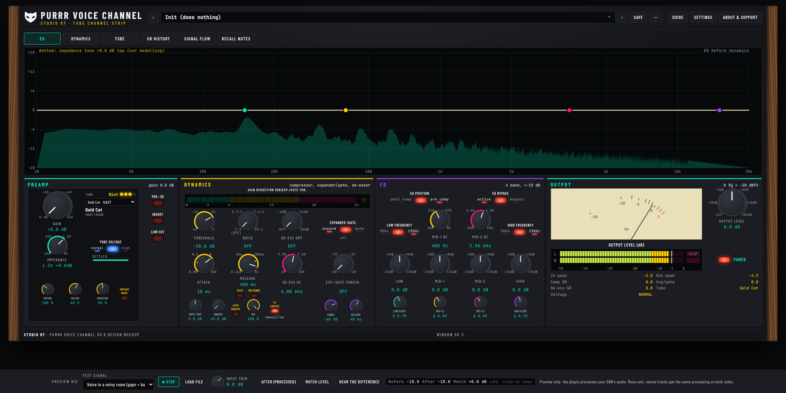

# Purrr Voice Channel 🐈

A tube channel strip plugin in the style of the ART Voice Channel: tube preamp, expander/gate, compressor/limiter, de-esser and a 4 band EQ in one window. Free and open source, VST3 for Linux (macOS and Windows later). By Studio 87.

## Status
Design mockup approved, plugin not built yet. The mockup is a playable page that runs the real signal chain in the browser (tube model, dynamics, EQ, loudness readout): [open the interactive mockup](docs/mockup/PurrrVoiceChannel.html) in your browser, or [try it on the Studio 87 website](https://speakingcolors.github.io/purrrvoicechannel/). The plugin will match it control for control.

## What it has
- **Preamp:** gain 0 to +60 dB, pad, invert, low cut, impedance tone, tube voltage (normal or high).
- **Tubes:** ten cat tubes on three real tube types (12AU7, 12AT7, 12AX7, new and aged), a Koren triode model with 4x oversampling and ADAA. The Gain knob drives the tube. Voicing, Colour and Variation knobs shape how different the tubes sound.
- **Dynamics:** expander or gate, compressor or limiter (release 0.1 ms to 3 s), de-esser, soft knee, sidechain high-pass, auto makeup, true-peak limiter.
- **EQ:** 4 bands, plus or minus 15 dB, pre or post dynamics, per-band Q.
- **Checking:** before and after with level match, LUFS readout, gain reduction history, dB scale on every meter.

## Roadmap
See [ROADMAP.md](ROADMAP.md).

## License
AGPL-3.0-or-later, see [LICENSE](LICENSE).

Not affiliated with or endorsed by ART Pro Audio. All trademarks belong to their owners.
