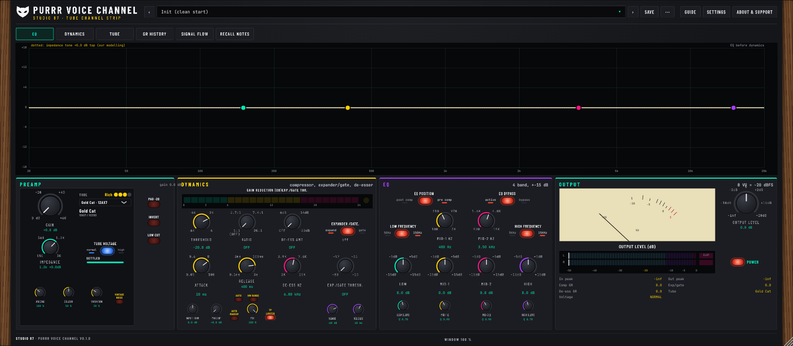

# Purrr Voice Channel 🐈

A tube channel strip plugin in the style of the ART Voice Channel: tube preamp, expander/gate, compressor/limiter, de-esser and a 4 band EQ in one window. Free and open source, VST3 and standalone for Linux, Windows and macOS. By Studio 87.

The real plugin window (Linux standalone build, 100 % size).

## Download
[Latest release](https://github.com/SpeakingColors/purrrvoicechannel/releases/latest): one zip with the Windows installer, the macOS installer, the Linux Flatpak and plain VST3, the PDF manual and INSTALL.txt. Everything works offline. Test build: not yet checked in a real DAW.

## Status
Version 0.1, first plugin build. The window is the approved mockup (the faceplate is taken from it, every control is drawn live at the same place) and the audio engine is the mockup's engine ported to C++, checked sample for sample against it (`tests/parity.mjs`, max difference -144 dB). [Open the interactive mockup](docs/mockup/index.html) in your browser, or [try it on the Studio 87 website](https://speakingcolors.github.io/purrrvoicechannel/) once GitHub Pages is on.

## What it has
- **Preamp:** gain 0 to +60 dB, pad, invert, low cut, impedance tone, tube voltage (normal or high).
- **Tubes:** ten cat tubes on three real tube types (12AU7, 12AT7, 12AX7, new and aged), a Koren triode model with 4x oversampling and ADAA. The Gain knob drives the tube. Voicing, Colour and Variation knobs shape how different the tubes sound.
- **Dynamics:** expander or gate, compressor or limiter (release 0.1 ms to 3 s), de-esser, soft knee, sidechain high-pass, auto makeup, true-peak limiter.
- **EQ:** 4 bands, plus or minus 15 dB, pre or post dynamics, per-band Q.
- **Checking:** gain reduction history, VU and peak meters with a dB scale (the mockup also has before and after with level match).

## Manual
[Manual (PDF)](docs/Purrr_Voice_Channel_manual.pdf): install and remove, and an interface tour with every control, its range, default and info bubble text. Built from the mockup by `tools/shoot_tour.py` and `tools/make_manual.py`; the release workflow puts it in the zip.

## Building
`cmake -S . -B build -DCMAKE_BUILD_TYPE=Release && cmake --build build` (JUCE is fetched). The engine is `include/purrvc/VoiceDsp.h` (no JUCE); `node tests/parity.mjs build/pvc_render` compares it with the mockup. After a mockup change run `python3 tools/extract_layout.py` to refresh the faceplate picture and the control positions.

## Roadmap
See [ROADMAP.md](ROADMAP.md).

## License
AGPL-3.0-or-later, see [LICENSE](LICENSE).

Not affiliated with or endorsed by ART Pro Audio. All trademarks belong to their owners.
